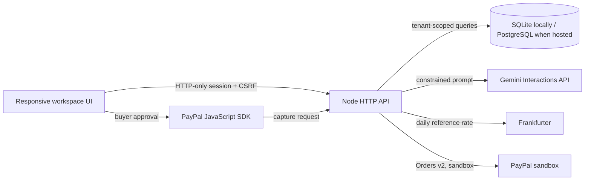
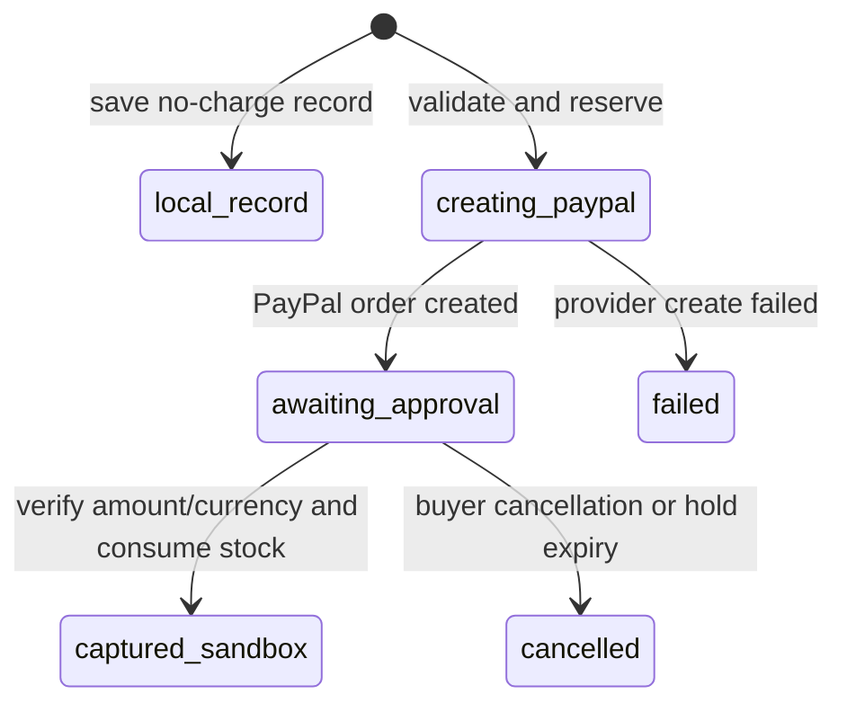

# Architecture — CommonThread

## Runtime and service boundaries

- Node.js 22.5+ HTTP server and built-in `node:sqlite` `DatabaseSync`.
- Vanilla HTML, CSS, and JavaScript client; no npm dependencies.
- Workspace routes require a valid server-side session. `/api/health`, `/api/markets`, `/api/contact`, and account sign-in routes are public.
- Gemini, PayPal sandbox checkout, Google OpenID Connect, and PayPal Login with PayPal are optional server-side integrations. Frankfurter supplies daily reference exchange rates for non-USD checkout.
- The server binds to `127.0.0.1` by default.

## Accounts and isolation

- `users` stores normalized email, display name, and a salted scrypt password hash.
- `workspaces` stores the community name, market code, and PayPal checkout currency.
- `workspace_members` defines the owner membership. Signup currently creates one owner and no invitations.
- `sessions` stores only a SHA-256 hash of a random opaque cookie token, a CSRF token hash, timestamps, and a seven-day expiry.
- `oauth_identities` maps provider subjects to accounts. `oauth_flows` stores short-lived state/browser bindings and the Google PKCE verifier for one-time callbacks.
- `auth_attempts` backs database-persisted sign-in throttling.
- `community_needs`, `agent_runs`, and `orders` carry `workspace_id`; request history, payment history, metrics, detail lookups, and support records are filtered through that workspace.
- `catalog_products` is the shared illustrative catalog. Stock reservation is therefore global within the local app.

The first account adopts any unassigned local requests, plans, and orders from a pre-account database. Later accounts start with an empty private workspace. Local SQLite uses foreign keys, WAL mode, checks, indexes, prepared statements, and `BEGIN IMMEDIATE` for multi-row writes. Hosted services can set `DATABASE_URL` to use PostgreSQL; a dedicated worker keeps the existing synchronous transaction boundary on one PostgreSQL connection.

Passwords use Node's scrypt implementation with a random salt and constant-time comparison. Cookies are HTTP-only and SameSite=Lax. Mutating authenticated routes require same-origin validation and a CSRF header tied to the session. Failed login attempts are throttled by IP/email hash. There is no email verification, password-reset delivery, MFA, workspace invitations, or role-based spending approval.

Google sign-in verifies the ID-token signature, issuer, audience, expiry, issue time, nonce, and verified email; the authorization-code exchange uses PKCE. PayPal sign-in uses its Identity API with only `openid profile email` and keeps access tokens transient. OAuth state is single-use and bound to an HTTP-only browser cookie. A verified provider email can attach to an existing non-demo account. The public judge account is isolated, reset at startup, and blocked from saving workspace edits or orders; planning and support chat remain available.

## Data model and money

- `community_needs`: workspace request text, USD planning cap, status, and creation time.
- `community_request_events`: immutable workflow history scoped through the parent request.
- `catalog_products`: platform starter SKU, base price in USD cents, shared stock, tags, allergens, and active flag.
- `agent_runs`: workspace, request, USD planning cap, constraints, source, and proposal JSON.
- `orders`: workspace, request snapshots, local-currency minor-unit budget and subtotal, USD base values, currency, FX rate/date, idempotency key, request fingerprint, provider references, and status.
- `order_items`: immutable names/SKUs and local-currency unit/line amounts; SQL checks enforce integer line arithmetic.
- `stock_reservations`: temporary held, consumed, or released shared catalog quantities.
- `audit_events`: immutable payment/order events.
- `support_tickets`: message and optional workspace/user references.
- `schema_migrations`: applied schema versions.

Planning limits and catalog prices remain in USD reference values. PayPal currencies are modeled with their correct number of minor digits. For a non-USD checkout, the server fetches the current daily USD-based Frankfurter rate, converts and rounds each catalog unit, recalculates the order in integer minor units, and saves the exact rate/date. It blocks checkout without a usable rate or if rounded item amounts exceed the approved cap. PayPal's own conversion quote and fees can differ.

## Request and planning lifecycle

Requests begin in `review`. Only an organizer can move them to `ready`; the server allows planning and checkout only for `ready` requests. Every status transition has an immutable activity event. “Ready” records local review and does not verify a requester or beneficiary.

The planner gets a ready request from the signed-in workspace, the USD reference cap, restrictions, and shared catalog facts. Gemini may propose product IDs and quantities only. Server-side rules remove unknown/unavailable products, enforce restrictions, and calculate the proposal. The assistant gets only workspace name, selected market/currency, aggregate request/order counts, and the user's question. It has no tools, cannot mutate data, and cannot start payment. Assistant conversations are not stored. Without `GEMINI_API_KEY`, product-support questions receive guided local answers.

## PayPal and reservation lifecycle

The server persists the workspace-scoped idempotency key and request fingerprint before calling PayPal. It snapshots and reserves current quantities in a database transaction, then sends one itemized Orders v2 purchase unit in the workspace checkout currency. Capture must be `COMPLETED` and match both the saved currency and integer minor-unit amount before the server consumes stock and records the capture reference. A local record calls no payment provider and does not reserve stock.

BRL, CNY, and MYR are restricted to in-country PayPal accounts. HUF, JPY, and TWD use zero fractional digits. The country list is a curated subset of PayPal's REST country list; country-specific product features may still differ. Country selection is not a guarantee that an account can receive a specific currency or transaction type.

## API and security

Authenticated routes are scoped to the signed-in workspace and return `Cache-Control: no-store`. Account mutations require a session CSRF token and same-origin check. Static paths are constrained to `public/`; the server sends CSP, `nosniff`, referrer, frame, and permissions headers. JSON bodies are size-limited. User text is rendered as text or escaped before insertion into HTML.

Gemini, PayPal, and database credentials stay server-side. Gemini calls use `store: false`. PayPal secrets are not sent to the browser. Public contact details are blank unless the operator configures `SUPPORT_EMAIL`, `SUPPORT_PHONE`, or `SUPPORT_URL`. Ticket submission stores a record in the configured database but does not send notification email.

## Operational limits

This build is for a local, single-instance hackathon workflow. It does not claim production readiness for public financial workloads. Add managed database and backups, deployment secret management, operational monitoring, email verification/recovery, MFA, invitations and roles, audit retention policies, provider webhooks and reconciliation, live supplier/inventory integrations, beneficiary verification, refunds, payouts, and fulfilment before a real launch. The starter catalog is illustrative and its stock is shared across local workspaces. The FX quote is a daily reference, not PayPal's final rate.
